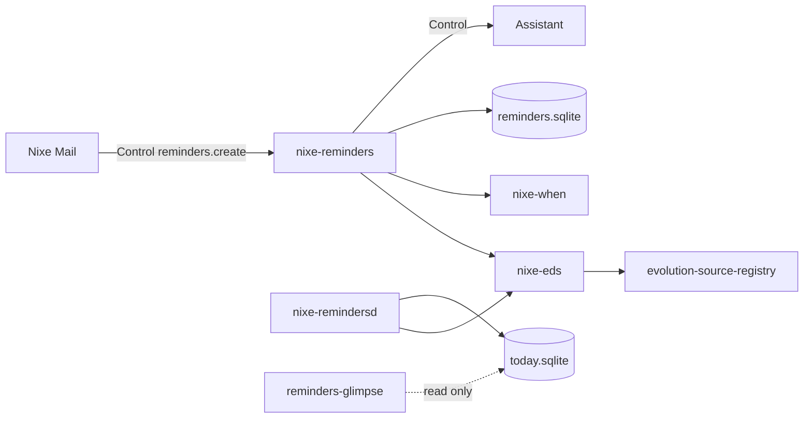

# Reminders architecture

## Where each field lives

| Field | Store |
| --- | --- |
| Title, notes, URL, due, start, completed, priority, repeat (RRULE), alerts (VALARM), subtasks (RELATED-TO) | VTODO in EDS |
| Flagged, tags, manual order, Mail message link | `reminders.sqlite`, keyed by `(source uid, task uid)` |

Sidecar rows whose task no longer exists in EDS are removed on the next full load.

## Backend capabilities

Each list gets a capability set from its backend, and the editor shows only what the
list can keep:

| Backend | Due time | Priority | Alerts | Repeat | Subtasks |
| --- | --- | --- | --- | --- | --- |
| Google Tasks (`gtasks`) | date only | no | no | no | yes |
| CalDAV VTODO | yes | yes | yes | yes | yes (server dependent) |
| This computer | yes | yes | yes | yes | yes |

These defaults are checked against EDS backend capabilities at runtime. A value is
never written to a backend that would drop it.

## Smart lists

Built from `ECalClient` queries over every enabled task list: Today (due today or
overdue), Scheduled (has a due date), Flagged (sidecar), All (not completed), Completed.

## `nixe-remindersd`

A GTK-free user service: `EReminderWatcher` on task lists, notifications with Complete
and Snooze, and `today.sqlite` for Glimpse.

## Control tools

Reads: `reminders.list`, `reminders.search`, `reminders.today`. Edits (confirmed in
Assistant): `reminders.create`, `reminders.complete`, `reminders.edit`, `reminders.delete`.
